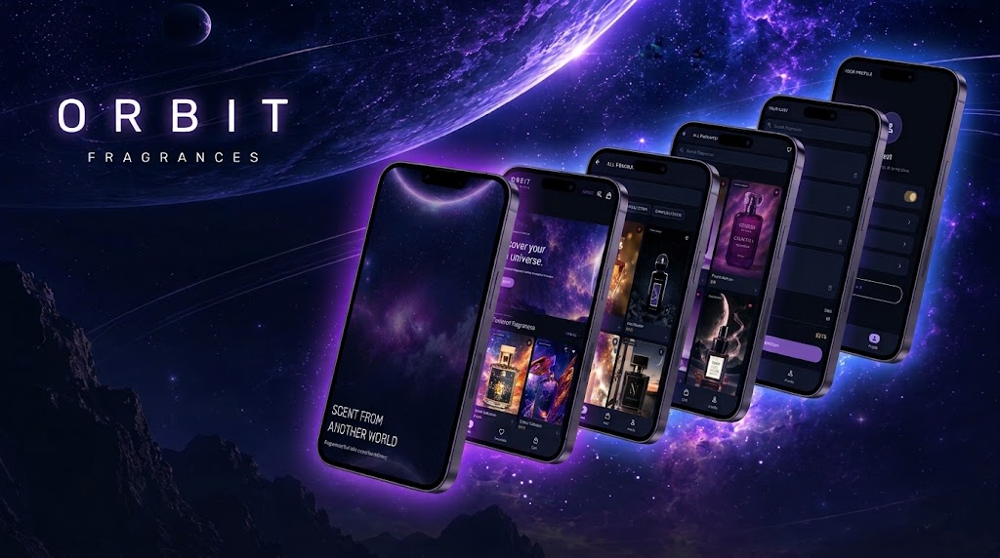
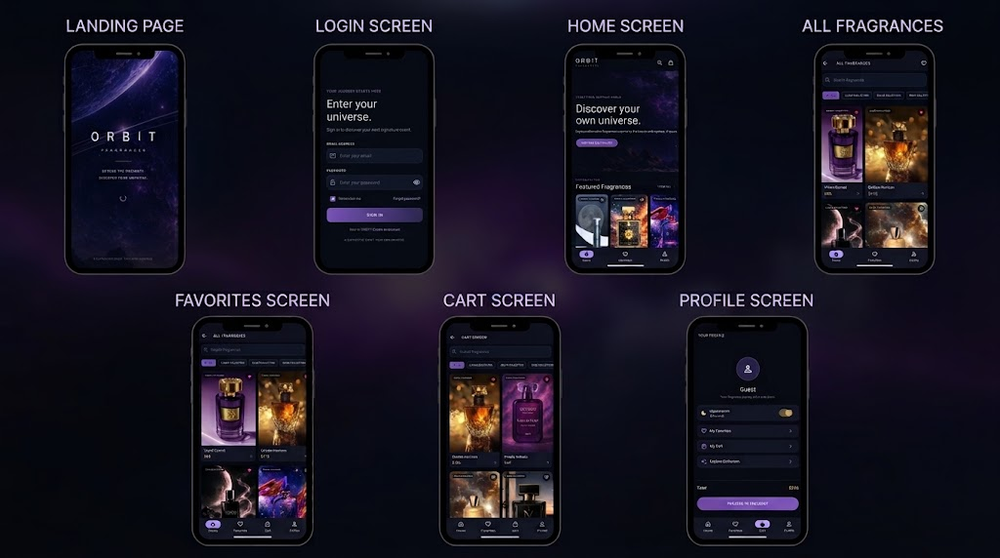

<div align="center">

# ✦ ORBIT FRAGRANCES

### A Universe of Scents. A Signature of Your Own.

*Explore beyond the ordinary. Discover your orbit.*

<br/>

[](https://flutter.dev/)
[](https://dart.dev/)
[](https://pub.dev/packages/go_router)
[](https://m3.material.io/)

**[Explore Features](#-features) · [Screenshots](#-screenshots) · [Installation](#-getting-started) · [Technologies](#-tech-stack)**

<br/>

[Live Demo](https://drive.google.com/file/d/1teBE2hdcT1U3FCbKNRAYn8k2i4gMxkIa/view?usp=sharing) 

</div>

---

## ✧ About the Project

**ORBIT Fragrances** is a space-inspired perfume shopping application built with Flutter.

Inspired by the mystery of deep space and the elegance of luxury perfumery, ORBIT combines a midnight color palette, cosmic violet, soft lavender, and gold accents to create a distinctive fragrance-discovery experience.

The project focuses on visual identity, reusable interface components, structured navigation, and a multi-screen shopping experience.

---

## ◈ Table of Contents

* [Features](#-features)
* [Screenshots](#-screenshots)
* [Tech Stack](#-tech-stack)
* [Project Structure](#-project-structure)
* [Getting Started](#-getting-started)
* [Application Flow](#-application-flow)
* [Future Improvements](#-future-improvements)


---

## ✦ Features

### 🌌 Cosmic Visual Identity

* Dark, space-inspired interface.
* Midnight navy, cosmic violet, lavender, and gold accents.
* Consistent visual styling across application screens.

### ✧ Fragrance Discovery

* Browse the fragrance catalog.
* Search fragrances by name.
* Explore fragrance collections.
* Open product details.

### ♡ Personal Experience

* Dedicated profile screen.
* Favorites and shopping-cart screens.
* Light and dark appearance modes.
* Username display in the profile, once connected to the login flow.

### 🚀 Application Navigation

* Named routes using GoRouter.
* Path parameters for product details.
* Query parameters for user information.
* Reusable widgets and organized page structure.

---

## ◈ Screenshots

### Adding Your Screenshots

Create a folder named `screenshots` in the project root:

```text
orbit_fragrances/
├── screenshots/
│   ├── sign_in.png
│   ├── home.png
│   ├── fragrances.png
│   ├── product_details.png
│   ├── favorites.png
│   └── profile.png
├── assets/
│   └── images/
├── lib/
├── pubspec.yaml
└── README.md
```

Save your actual application screenshots using these filenames. GitHub will display them automatically when the paths match.

---

## ✧ Tech Stack

| Technology     | Purpose                       |
| -------------- | ----------------------------- |
| Flutter        | Cross-platform UI development |
| Dart           | Application logic             |
| Material 3     | UI components and theming     |
| GoRouter       | Declarative navigation        |
| StatefulWidget | Local interactive state       |
| ValueNotifier  | Application-wide theme state  |
| MediaQuery     | Screen-size information       |

### Technology Links

* [Flutter Documentation](https://docs.flutter.dev/)
* [Dart Documentation](https://dart.dev/guides)
* [GoRouter Package](https://pub.dev/packages/go_router)
* [Material Design 3](https://m3.material.io/)

---

## ◇ Project Structure

```text
orbit_fragrances/
│
├── assets/
│   └── images/
│
├── screenshots/
│
├── lib/
│   ├── main.dart
│   ├── orbit_data.dart
│   ├── product_widgets.dart
│   │
│   └── pages/
│       ├── splash_page.dart
│       ├── login_page.dart
│       ├── home_page.dart
│       ├── all_fragrances_page.dart
│       ├── product_details_page.dart
│       ├── favorites_page.dart
│       ├── cart_page.dart
│       └── profile_page.dart
│
├── pubspec.yaml
└── README.md
---

## 🚀 Getting Started

### Prerequisites

* Flutter SDK
* Dart SDK compatible with the project
* Chrome or an Android emulator
* Git

### Installation

**1. Clone the repository**

```bash
git clone YOUR_GITHUB_REPOSITORY_URL
cd orbit_fragrances
```

**2. Install dependencies**

```bash
flutter pub get
```

**3. Analyze the project**

```bash
flutter analyze
```

**4. Run in Chrome**

```bash
flutter run -d chrome
```

**5. Build for the web**

```bash
flutter build web
```

The generated web application will be available in `build/web/`.

---

## ◈ Application Flow

```text
Splash
  │
  ▼
Sign In
  │
  ▼
Home
  ├── All Fragrances
  │      └── Product Details
  │
  ├── Favorites
  │
  ├── Cart
  │
  └── Profile
         ├── Appearance Settings
         └── Sign Out
```

This diagram represents the intended navigation structure. Actual behavior depends on the final implementation of each screen.

---

## ✧ Future Improvements

Potential extensions include:

* Persistent user preferences.
* Persistent favorites and cart data.
* More detailed fragrance profiles and scent notes.
* Advanced search and filtering.
* User authentication.
* Checkout and order management.
* Improved accessibility and responsive layouts.

---

<div align="center">

### ✦ Find Your Scent. Find Your Orbit. ✦

*A fragrance is more than a scent. It is a world of its own.*

**ORBIT FRAGRANCES**

</div>
